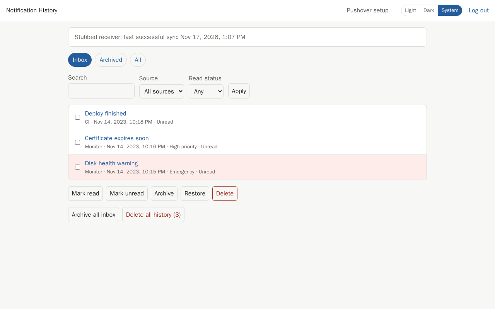
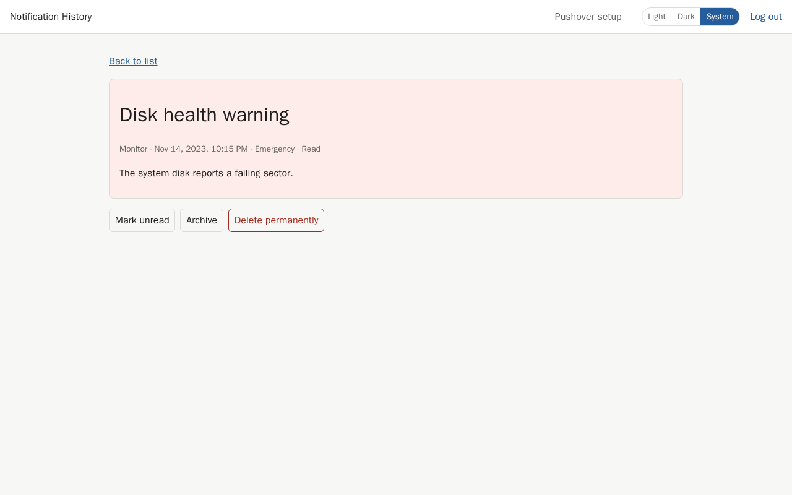

# Pushover Desktop Client

Notification history for a dedicated Pushover device.

It registers this client as an Open Client device on your Pushover account, stores every
notification it receives in SQLite, and serves a server-rendered web interface for reading,
searching, archiving and deleting that history. Read status, Inbox/Archived membership and
deletion are local to this client.

[MIT licensed](LICENSE). Report vulnerabilities through [SECURITY.md](SECURITY.md), not a public
issue.

## Screenshots





Both images show the stub backend's demo messages, not real notifications. They are regenerated
from that same stub data with the script in [Development](#development).

## What it does

- Receives notifications through the Pushover Open Client API as a dedicated device.
- Keeps title, body, Pushover timestamp, priority, source application and link.
- Newest-first list, detail view, text search, Inbox/Archived/All scopes, source and read filters.
- Opening a notification marks it read; selected mark read/unread, archive, restore and delete.
- Archive all moves the whole Inbox; Delete all history shows the affected count and requires
  confirmation.
- Shows receiver connection state and the last successful sync, and refreshes the list
  automatically without losing filters.

## Quick start

Today you build the image from source. A published container image is coming; until it exists,
this is the only install path.

```bash
ADMIN_PASSWORD='choose-a-strong-password' docker compose up --build -d
```

Open <http://127.0.0.1:8080>, log in with the password you just set, then open
**Pushover setup** and sign in with your Pushover email and password. If your account uses
two-factor authentication, enter the code on the next screen. After a successful sign-in this
client is registered as a dedicated device and starts collecting.

The only persistent path is `/data` (bind-mounted from `${DATA_DIR:-./data}`). It holds the
SQLite database, the session-signing key and the Pushover receiving session.

### Try it without Pushover

```bash
COLLECTOR_BACKEND=stub ADMIN_PASSWORD='choose-a-strong-password' docker compose up --build -d
```

The stub backend fills the history with deterministic demo messages, so you can read the
interface before touching a Pushover account. Nothing leaves the machine.

## Environment variables

| Variable | Default | Meaning |
| --- | --- | --- |
| `DATA_DIR` | `./data` (host bind) / `/data` (container) | Host directory mounted as `/data` inside the container. |
| `BIND_ADDRESS` | `127.0.0.1` | Host address the web port is published on. |
| `ADMIN_PASSWORD` | none | Administrator password. Required unless `AUTH_DISABLED=true`. |
| `AUTH_DISABLED` | `false` | `true` disables the login screen entirely. |
| `COLLECTOR_BACKEND` | `pushover` | `pushover` uses the real API; `stub` uses deterministic demo messages. |
| `COLLECTOR_INTERVAL` | `30` | Seconds between collection attempts; failures back off automatically. |
| `PAGE_SIZE` | `50` | List page size. |

## Security and exposure

This service is for **local network access only**. Do not publish it to the internet and do not
put a tunnel, Proxy or public route in front of it. Reach it from other devices on your LAN
through the host's own address, behind your existing private HTTPS routing if you have it.

Setting `AUTH_DISABLED=true` turns off the login screen: anyone who can reach the port can read
and permanently delete your notification history. Only do this on a network you trust.

Pushover passwords and two-factor codes are used only for the request that submits them. They
are never logged and never stored. Only the receiving session secret, device ID and non-secret
configuration are written under `/data`, with owner-only permissions.

To report a vulnerability, use GitHub private vulnerability reporting as described in
[SECURITY.md](SECURITY.md).

## Backups and deletion

- Back up the whole `/data` directory: the database, the session key and the Pushover session.
  The container runs as uid 10001 and some files are owner-only, so copy the directory as root
  (for example `sudo tar -C "$DATA_DIR" -czf history-backup.tgz .`).
- Removing the bind-mounted directory needs root for the same reason: files under `/data` belong
  to uid 10001. Stop the container first, then `sudo rm -rf "$DATA_DIR"`. A permission-denied
  `rm` means ownership, not corruption.
- Permanent deletion and Delete all history remove notifications from this client's active
  history only. Older backup copies are not touched and expire under your backup policy.
- Deleted notifications cannot be restored, and late redelivery from Pushover cannot bring them
  back: a content-free delivery receipt is kept so the same message is never resurrected.

## Honest limits

- **No attachments.** The Open Client API does not expose image downloads; view images in the
  official Pushover app.
- **No emergency acknowledgement.** Emergency notifications are shown with a distinct indicator,
  but this client never acknowledges them. Acknowledge emergencies in the Pushover app.
- **No public deployment.** LAN only, no tunnel, no inbound route.
- **Upstream retention limit.** Pushover keeps unconfirmed messages for at most 21 days, so a
  long outage can leave a permanent gap. Saved history stays available and the status line never
  claims a full recovery.
- **Tests use a mocked Pushover.** No test or QA run contacts Pushover, and no live credential
  validation is part of this repository's checks.

## Development

```bash
python3 -m venv .venv
.venv/bin/python -m pip install --upgrade pip
.venv/bin/python -m pip install -e '.[dev]'
.venv/bin/pytest -q
.venv/bin/ruff check .
.venv/bin/ruff format --check .
```

Run locally with the stub backend:

```bash
DATA_DIR="$(mktemp -d)" ADMIN_PASSWORD=dev COLLECTOR_BACKEND=stub \
  .venv/bin/uvicorn app.main:create_app --factory --port 8080
```

Offscreen browser QA (headless Chromium, disposable data directory):

```bash
(
  set -euo pipefail
  export DATA_DIR="$(mktemp -d /tmp/pdc-qa.XXXXXX)"
  export COMPOSE_FILE="compose.yaml:compose.qa.yaml"
  trap 'docker compose down --volumes --remove-orphans; case "$DATA_DIR" in /tmp/pdc-qa.*) rm -rf -- "$DATA_DIR" ;; *) printf "Refusing unexpected DATA_DIR: %s\n" "$DATA_DIR" >&2 ;; esac' EXIT
  docker compose up --build --abort-on-container-exit --exit-code-from qa
)
```

The browser flow lives in `qa/flow.py`: a plain Playwright script, not a pytest module. The QA
container runs it with `python qa/flow.py`, prints one line per checked behaviour, and exits
nonzero on the first failure.

Regenerate the screenshots above (same stub data, isolated Compose project, always torn down):

```bash
(
  set -euo pipefail
  export COMPOSE_FILE="compose.yaml:compose.qa.yaml"
  trap 'docker compose -p screenshots down --volumes --remove-orphans' EXIT
  mkdir -p docs/screenshots
  docker compose -p screenshots up --build -d app
  docker compose -p screenshots run --rm qa python /qa/screenshots.py
)
```

`qa/screenshots.py` logs in, captures the Inbox list and the "Disk health warning" detail page at
1280x800, and writes `docs/screenshots/history-list.png` and `docs/screenshots/history-detail.png`.
Because the container writes as root, `sudo chown "$(id -u):$(id -g)" docs/screenshots/*.png`
afterwards keeps the files yours.

## Reporting issues

- Bugs and feature requests: open an issue on this repository's Issues tab.
- Vulnerabilities: do not open a public issue. Use GitHub private vulnerability reporting, as
  described in [SECURITY.md](SECURITY.md).
